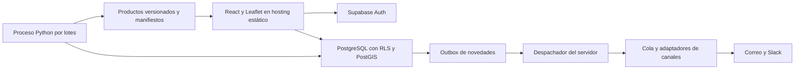

# Sentinela Selknam

## Arquitectura objetivo y plan de implementación

El objetivo es que un equipo ambiental pueda recorrer el sector argentino de la Isla Grande de Tierra del Fuego, comparar observaciones, revisar cambios de agua y vegetación y dar seguimiento a zonas que merecen comprobación. El sistema debe conservar las fuentes, las decisiones y sus responsables. Las intervenciones en territorio corresponden a las autoridades y equipos competentes.

El alcance acordado es la Isla Grande de Tierra del Fuego. El mapa funciona como selector de un recorte rectangular de 5,12 × 5,12 km. La aplicación busca y procesa observaciones Sentinel-2 en el navegador y abre el mismo recorrido de comparación y revisión del piloto. La cobertura se consulta bajo demanda; no existe todavía un mosaico completo analizado ni una validación ambiental de toda la isla.

## Estado real de construcción

| Capacidad | Estado verificable | Trabajo pendiente |
| --- | --- | --- |
| Recortes bajo demanda | Selección de punto, COG Sentinel-2, procesamiento 10 m en Worker, comparación, fichas y descarga | Publicación compartida, procesamiento institucional y ventanas configurables |
| Piloto preparado | Recorte real de 3,69 km², grilla de 10 m, 200 componentes exploratorios | Validación independiente y calibración |
| Interfaz | Recorrido guiado, lista, ficha, motivo y guardado de prueba | Evaluación con operadores y lector de pantalla |
| Supabase | Cliente Auth y SQL con RLS y revisión transaccional, probado en PostgreSQL embebido | Configurar proyecto remoto y probar con cuentas reales |
| Persistencia de demostración | Revisiones locales y hasta seis recortes en IndexedDB | Historial compartido, auditoría y copias remotas |
| Exportación de revisiones | Panel con PDF de la zona y CSV de las zonas revisadas del recorte. También se descargan GeoJSON, PNG y manifiesto. | Exportación compartida con permisos e historial por ejecución |
| Publicación | GitHub Pages y código descargable | Entornos separados, despliegue institucional y operación |
| Alertas | Arquitectura y etapas definidas aquí | Outbox, reglas, bandeja, adaptadores y destinatarios |
| AWS | Plantilla Lightsail heredada y Terraform de referencia en `infra/terraform` | Implementar las imágenes, probar la arquitectura en una cuenta de staging y verificar costos |

El piloto se conserva como producto preparado. Los nuevos recortes generan sus propias ejecuciones locales y geometrías con fechas, cobertura y trazabilidad. La validación biológica sigue pendiente. La aplicación no afirma que los cambios sean diques ni presencia confirmada de castores.

El [inventario de módulos](primer-avance/MODULOS.md) describe la implementación actual. El [instructivo](primer-avance/GUIA_DE_USO.md) documenta el recorrido en la app publicada.

## Fuentes y alcance territorial

Los recortes consultan Earth Search y leen COG Sentinel-2 L2A desde almacenamiento público. Se buscan observaciones entre enero y marzo de 2020 y 2026 y se seleccionan escenas utilizables según SCL, con búsqueda acotada. Se muestran fechas efectivas, superficie común y píxeles excluidos. Los índices y componentes se calculan sobre 10 m; SCL procede de 20 m. El método y sus límites se detallan en [primer-avance/README.md](primer-avance/README.md#método-de-los-recortes-bajo-demanda). [Earth Search](https://github.com/element84/earth-search)

La fase actual realiza el cómputo en un Worker del navegador y conserva hasta seis recortes en IndexedDB, sujeto a cuota o borrado del dispositivo. Esto permite explorar otras zonas sin un servidor de análisis. El catálogo y los COG requieren conectividad y CORS; el piloto preparado permanece como alternativa. La operación institucional requiere centralizar ejecuciones, productos y revisiones con permisos, respaldo y supervisión. Para los recortes nuevos, la identidad incluye grilla, escenas, fechas, hash del método y contenido de las bandas muestreadas.

El contorno procede de IGN WFS, capa ign:provincia, código 94. Se seleccionó el mayor polígono terrestre conectado dentro del encuadre de la Isla Grande. Se generalizó para pantalla con una tolerancia de 0,004 grados y se usa como referencia de navegación. Las áreas del algoritmo se calculan con su geometría y grilla de análisis. El manifiesto del selector conserva la fuente y hash del contorno original y de sus recursos. Los manifiestos de cada recorte conservan los insumos satelitales y sus hashes. Los rótulos de localidades proceden de Georef. [IGN WFS](https://wms.ign.gob.ar/geoserver/ows?service=WFS&request=GetCapabilities), [Georef](https://apis.datos.gob.ar/georef/api/localidades?provincia=94&max=100)

Para publicar y compartir los candidatos calculados en el sector argentino de la isla se requiere un catálogo institucional de áreas y ejecuciones Sentinel-2 L2A. La inferencia ambiental necesita resolución, máscaras, fechas comparables y evidencia adecuadas a cada ambiente. Los umbrales del piloto siguen siendo exploratorios.

## Producto operativo previsto

El visitante consulta análisis publicados por la organización. El operador autorizado ve sus áreas, cobertura, novedades y fichas pendientes. Compara períodos, registra una revisión con motivo y evidencia y deja un seguimiento. La persona administradora gestiona miembros, publicaciones, reglas y destinatarios.

Los sectores tendrán estados fechados de pendiente de procesamiento, procesando, datos insuficientes, análisis disponible o error recuperable. Cuando exista observación válida y ningún componente alcance los criterios, la pantalla mostrará ese resultado y su superficie observable. La ausencia animal requiere otras fuentes.

Una alerta abre una ficha. El operador reconoce la novedad, la asigna a un responsable y registra cómo se resolvió. Los descartes y causas alternativas se conservan para evaluar el método.

## Etapa inicial con Supabase



Esta etapa permite validar el flujo con un equipo pequeño. Las operaciones privadas usan sesión autenticada y RLS. Procesador y despachador se ejecutan del lado servidor y mantienen allí sus credenciales. La continuidad de Supabase Free requiere revisar cuotas y condiciones de pausa. [RLS](https://supabase.com/docs/guides/database/postgres/row-level-security), [Planes y cuotas](https://supabase.com/pricing)

Como primera etapa con usuarios reales, se propone conservar Supabase y sumar un worker GIS Lambda en `us-west-2` si se necesita procesar en el servidor. El worker entregaría productos a S3 y resultados a Supabase con permisos de servidor. Antes, probar Supabase remoto y portar el trabajador. La migración integral a AWS responde a requisitos institucionales de control, datos u operación.

Primero se configura Supabase, se aplican las migraciones existentes, se habilitan operadores y se comprueba aislamiento entre dos organizaciones. Luego se agrega una migración versionada para áreas, escenas, ejecuciones y publicaciones. El piloto recibe una ejecución de origen y sus identificadores anteriores se conservan como alias, manteniendo sus revisiones y exportaciones.

## Arquitectura administrada objetivo en AWS

La [propuesta DevOps en AWS](DEVOPS_AWS.md) y el [Terraform de referencia](infra/terraform/README.md) describen el piloto administrado en `us-west-2`. Usan HTTP API, Cloud Map y una API Fargate, sin NAT ni ALB. Lambda procesa los recortes y otra Lambda ingiere sus manifiestos en RDS privado. GitHub Actions con OIDC es el camino principal. CodePipeline y CodeBuild son una variante de publicación del frontend, y CodeDeploy permite ensayar una liberación canaria de la Lambda GIS. CloudWatch concentra métricas y registros, con Grafana y Prometheus como ampliaciones.

La API valida identidad, organización, rol, propiedad del recurso y cuotas. Los tokens Cognito deben comprobar emisor y audiencia. La consulta pública devuelve solo los campos publicados. Los productos privados usan acceso autorizado o URL firmadas de vigencia limitada. Los rásteres grandes se sirven desde almacenamiento de objetos y teselas.

La base queda en red privada. El perfil piloto presupone salida HTTPS por la IPv4 de la tarea Fargate y un gateway endpoint de S3 para la ingesta. Presupuestar costo por IP, egreso y transferencia entre zonas. NAT, balanceador y endpoints adicionales se cotizan si cambian las políticas institucionales. La concurrencia se limita según el presupuesto.

La migración desde Supabase requiere inventario, copia verificada, correspondencia de identidades, ensayo de permisos y restauración. En RDS, sustituir `auth.uid()` y `auth.jwt()` por contexto de transacción establecido por la API tras verificar identidad y membresía. Aplicar RLS a roles de aplicación sin privilegios de bypass y repetir las pruebas de aislamiento con dos organizaciones contra RDS.

## Procesamiento del sector argentino de la isla reproducible

1. Versionar áreas oficiales, cuencas y capas de referencia con fuente, licencia, fecha y CRS. Seleccionar ambientes y prioridades con operadores.
2. Dividir la cobertura en unidades acotadas de trabajo. Una solicitud para el sector argentino de la isla genera tareas por sector y período. Una identidad estable evita repetir tareas equivalentes.
3. Consultar Sentinel-2 L2A y elegir ventanas estacionalmente comparables. Conservar escenas, máscaras, escalas y offsets.
4. Guardar insumos o recortes inmutables con checksums, entorno, código y parámetros. Detectar cambios posteriores del proveedor.
5. Enmascarar nubes, sombras, nieve y valores inválidos. Alinear grillas y calcular índices y cobertura común.
6. Aplicar reglas calibradas por ambiente, filtrar ruido y vectorizar. Calcular superficies con el CRS apropiado. Conservar descartes para evaluación.
7. Publicar COG, teselas, geometrías, manifiestos, calidad y estado por sector. Un fallo parcial debe permitir reintentar sectores sin duplicar resultados completos.
8. Contrastar con evidencia independiente y una muestra de áreas sin señales. Medir errores, acuerdo entre revisores y utilidad operativa.

Se deben distinguir calidad de observación, confianza del método, prioridad operativa y evidencia biológica. Un candidato espectral y una observación confirmada necesitan estados y fuentes propios.

## Modelo de datos a completar

| Entidad | Campos y garantías principales |
| --- | --- |
| Organización y miembro | Usuario, rol administrativo, estado y alcance |
| Área | Geometría, CRS, fuente, versión y organización |
| Escena | Proveedor, fecha, activos, licencia y checksums |
| Ejecución | Área y versión, ventanas, método, parámetros, identidad única, calidad y estado |
| Producto | Ejecución, ubicación, versión, tamaño, hash y publicación |
| Candidato | UUID, ejecución, geometría, señal, superficie y procedencia |
| Revisión | Candidato, autor de sesión, motivo, evidencia, estado y versión |
| Caso de seguimiento | Responsables, prioridad, reconocimiento y resolución |
| Regla de alerta | Organización, ámbito, condición, versión, destinatarios y vigencia |
| Outbox | Event ID único, carga mínima, estado, intentos y siguiente intento |
| Entrega | Evento, canal, destinatario, resultado, ID del proveedor y fechas |
| Auditoría | Actor, operación, recurso, fecha y contexto mínimo |

Se requieren índices por organización, área, estado, fecha y geometría según consultas medidas. Listas y exportaciones grandes llevan paginación, límites y autorización. La identidad de una ejecución combina área y versión, períodos, método, parámetros y versión de datos.

## Alertas ambientales y de operación (implementación futura)

SNS y los canales de avisos pertenecen a esta arquitectura futura. La aplicación actual no incluye una sección de alertas ni controles para configurar o enviar mensajes.

Los primeros disparadores propuestos son candidatos pendientes tras un análisis completado, cobertura insuficiente y fallos técnicos de procesamiento o entrega. Cada uno tiene destinatarios y condiciones propios.

La alerta ambiental incluye área, períodos, ejecución, señal, cobertura común, nivel de revisión y enlace a la ficha. El título describe el evento, por ejemplo «Cambios de agua pendientes de revisión en el sector seleccionado». La confirmación de presencia o impacto animal se vincula a su evidencia.

Las reglas se habilitan por organización. Se definen frecuencia máxima, agrupación por área, horarios, destinatarios y requisitos de calidad. Un resumen puede reunir candidatos de una misma ejecución. La prioridad puede incorporar tomas de agua, accesibilidad y otras capas verificadas.

### Flujo de entrega

1. La transacción que guarda el resultado registra también el evento de outbox, con ID estable y restricción única por ejecución, regla y versión.
2. El despachador toma eventos con control de concurrencia y publica en SNS usando su rol IAM. Registra la respuesta.
3. SNS distribuye a una cola por canal. Los consumidores deduplican por evento, destinatario y canal, comprueban que la regla siga activa y llaman al adaptador.
4. Cada intento conserva resultado e identificador del proveedor. Los fallos transitorios reintentan con espera creciente. Los persistentes van a DLQ y se reencolan de forma auditada.
5. La bandeja permite reconocer y asignar la novedad. El estado del caso y el de la entrega se almacenan por separado.

Las entregas pueden repetirse. Un corte tras la aceptación por un proveedor externo puede dejar un resultado ambiguo. Se usan claves de idempotencia cuando el proveedor las admita y se conserva la respuesta para decidir un reenvío. La aceptación del mensaje y la lectura por una persona son evidencias diferentes. [SNS y colas SQS](https://docs.aws.amazon.com/sns/latest/dg/sns-sqs-as-subscriber.html)

### Canales

| Canal | Implementación prevista | Configuración necesaria |
| --- | --- | --- |
| Bandeja interna | Evento y caso por organización | Usuarios, permisos y alcance |
| Correo inicial | Email SNS para avisos simples | Direcciones y suscripciones confirmadas |
| Correo operativo | SQS, Lambda y SES | Remitente autorizado, permisos y rebotes |
| Slack | SQS y Lambda con webhook, o SNS con Amazon Q Developer y formato compatible | Workspace, canal, app autorizada y secreto |
| WhatsApp | SQS y Lambda con AWS End User Messaging Social o proveedor compatible | Cuenta WhatsApp Business, número, autorización de destinatarios y plantillas necesarias |

El webhook Slack espera su propio formato. El adaptador transforma el evento y guarda la URL secreta del lado servidor. Amazon Q Developer en aplicaciones de chat admite notificaciones personalizadas sobre SNS con un esquema específico. [Webhooks Slack](https://docs.slack.dev/messaging/sending-messages-using-incoming-webhooks/), [Notificaciones de Amazon Q](https://docs.aws.amazon.com/chatbot/latest/adminguide/custom-notifs.html)

AWS End User Messaging Social integra WhatsApp mediante una cuenta WhatsApp Business. Habilitación, reglas y cargos se verifican con la cuenta real. Se conserva la autorización del destinatario y un mecanismo para detener avisos. [AWS End User Messaging Social](https://docs.aws.amazon.com/social-messaging/latest/userguide/what-is-service.html), [Email SNS](https://docs.aws.amazon.com/sns/latest/dg/sns-email-notifications.html)

### Ejemplo de contrato

Los valores siguientes son ilustrativos. Describen un formato propuesto.

```json
{
  "schema_version": 1,
  "event_id": "UUID_ESTABLE",
  "type": "analysis.candidates_ready",
  "organization_id": "ORGANIZACION",
  "run_id": "EJECUCION",
  "area_id": "AREA_VERSIONADA",
  "rule_version": "VERSION_DE_REGLA",
  "quality": {"common_valid_fraction": 0.9},
  "review_state": "pending",
  "candidate_count": 3,
  "private_record_url": "https://DOMINIO_DEL_SERVICIO/analisis/EJECUCION"
}
```

La condición se evalúa en el servidor con parámetros acordados. El mensaje incluye el mínimo necesario. Los detalles restringidos se consultan en la ficha autenticada. Los secretos y datos personales innecesarios quedan fuera del mensaje.

## Hoja de ruta y aceptación

| Etapa | Entregable | Se considera lista cuando |
| --- | --- | --- |
| 1. Persistencia real | Supabase, miembros y revisión compartida | Dos cuentas acceden solo a lo autorizado y las versiones obsoletas producen conflicto |
| 2. Piloto ambiental | Área acordada y referencias independientes | Se revisan positivos y omisiones con evidencia y límites documentados |
| 3. Ejecuciones versionadas | Migración, catálogo y productos por ejecución | El piloto conserva sus revisiones y se reproduce una ejecución nueva |
| 4. Procesamiento por sectores | Cola idempotente y estados de cobertura | Un lote parcial se reintenta sin duplicar ni ocultar fallos |
| 5. Seguimiento | Bandeja, responsable, prioridad y cierre | Un operador reconoce una novedad y registra evidencia y resolución |
| 6. Correo y Slack | Outbox, SNS, colas, adaptadores y DLQ | Se prueban eventos repetidos, fallo de proveedor, reintento y recepción autorizada |
| 7. WhatsApp | Canal habilitado según necesidad | Cuenta y número operativos, plantillas probadas y destinatarios autorizados |
| 8. Operación AWS | Infraestructura, despliegue y monitoreo | Se recrea la instalación y pasan los controles de acceso y alarmas |
| 9. Recuperación | Backups y manuales | Se recuperan base, geometrías, archivos y permisos en otro entorno y se mide el tiempo |
| 10. Evaluación de cobertura de la isla | Cobertura y carga representativas | Se miden calidad, costo, errores y tiempo de revisión frente al flujo actual |

El próximo incremento debería completar persistencia real y ejecuciones versionadas. Después se implementan la bandeja y el primer canal de avisos sobre datos trazables. La cobertura y la validación avanzan por sectores según disponibilidad y capacidad de revisión.

Los [criterios de madurez para una herramienta operativa](CRITERIOS_DE_MADUREZ.md) priorizan validación ambiental, comparabilidad temporal, datos compartidos, reproducibilidad, continuidad de los trabajos, recuperación y evaluación con operadores. El diseño de la interfaz y el footer de la demo no acreditan por sí solos esos criterios ni una adopción institucional.

## Validación de campo con cámaras trampa

**Estado.** Propuesta de mejora futura para el sector argentino de la Isla Grande de Tierra del Fuego. La demo pública en GitHub Pages todavía funciona con evidencia satelital y revisiones del operador. La incorporación de cámaras y la precisión de SpeciesNet en imágenes locales quedan por evaluar.

**Objetivo.** Usar los cambios de agua y vegetación observados desde el satélite para priorizar sitios de inspección. Una cámara trampa puede aportar evidencia de actividad reciente de castores en un punto determinado. Una foto confirmada documenta presencia en un lugar y momento. Atribuir un cambio hídrico a un dique requiere inspeccionar el sitio y relacionar las observaciones con las fechas del recorte. La ausencia de registros se interpreta como falta de detección durante el período observado. Un estudio de Exactas UBA encontró que la efectividad de las cámaras para detectar castores remanentes o que volvieron a ocupar sitios varió según el ambiente y la estación. [Tesis de Exactas UBA](https://bibliotecadigital.exactas.uba.ar/collection/tesis/document/tesis_n7126_Jusim)

**Evaluación e integración.**

1. **Probar con imágenes locales.** Conseguir fotos o secuencias etiquetadas por el equipo ambiental e incluir casos de día y de noche, animales parcialmente visibles y eventos sin castores. CameraTrapAI combina MegaDetector, que localiza animales en las imágenes, y SpeciesNet, que sugiere la especie. Comparar las sugerencias con la revisión humana, medir detecciones correctas, falsas alarmas, omisiones y tiempo por evento, y comprobar el efecto del filtro geográfico para Argentina. [Repositorio de CameraTrapAI](https://github.com/google/cameratrapai)
2. **Probar la ficha con evidencia de campo.** Si el ensayo justifica un piloto, acordar unos pocos sitios con el equipo ambiental y comenzar con cámaras infrarrojas, tarjetas SD y procesamiento local por lotes. Guardar la foto seleccionada, el sitio, la fecha de captura, la observación y quién la revisó. Vincular el registro a la zona revisada para poder reutilizarlo con recortes de otras fechas. La ficha y el PDF podrían presentar la foto junto a la comparación satelital, con su fecha y alcance.
3. **Automatizar según el volumen.** Si el piloto ahorra trabajo, evaluar una carga autenticada a S3 privado y una cola de procesamiento por lotes. Las predicciones quedarían pendientes de revisión humana y se guardaría la versión del modelo y su puntuación para trazabilidad. Restringir el acceso a originales y ubicaciones, y acordar la retención de capturas que puedan incluir personas.

**Presupuesto.** Cotizar por separado equipos, instalación, baterías, visitas, revisión humana, almacenamiento y cómputo adicional. La decisión de escalar depende de la utilidad de la evidencia para priorizar inspecciones y del costo de obtenerla y revisarla.

## Seguridad y operación

Las pruebas incluyen operaciones anónimas, aislamiento, modificación de roles, concurrencia, duplicación de tareas y eventos, tamaños excesivos, sesión vencida y caída de proveedor. Los callbacks verifican autenticidad. El servidor limita destinos, tipos y tamaños y protege reenvíos y administración.

Base y productos tienen políticas de respaldo, retención y acceso. Se proponen RPO de 24 horas y recuperación en una jornada, que necesitan medición en un ensayo remoto. Las pruebas de restauración acreditadas del prototipo anterior corresponden a SQLite local.

Las alarmas técnicas abarcan fallos, edad de tareas, DLQ, tiempo de proceso, cobertura insuficiente, errores de API, almacenamiento y gasto. Cada alarma necesita responsable y acción en el manual operativo.

## Presupuesto y decisiones pendientes

El [presupuesto AWS](DEVOPS_AWS.md#presupuesto-de-referencia) desglosa puesta en marcha y operación de tres escenarios: demo estática, piloto administrado y base de producción redundante. Dimensiona un piloto de 100 recortes por mes.

El prototipo puede tener desembolso incremental cero con datos abiertos, equipo local y planes gratuitos dentro de sus cuotas. La operación del sector argentino de la isla debe estimar escenas y productos almacenados, cómputo, transferencia, base, copias y avisos por canal. Las tarifas y elegibilidad se verifican en la cuenta y región elegidas.

El presupuesto previo del piloto y el de cobertura insular tienen alcances diferentes. Antes de cotizar la ampliación se deben medir ejecuciones representativas y acordar frecuencia, retención, usuarios, validación de campo y disponibilidad. WhatsApp, correo, SNS y adaptadores se presupuestan por tráfico y condiciones efectivas.

Quedan por definir organización operadora, responsables ambiental y técnico, áreas y capas prioritarias, cadencia, niveles de evidencia, destinatarios, canales, región, privacidad y conservación. AWS Budgets aporta avisos y se complementa con cuotas y límites de ejecución.

## Referencias

- [NASA GIBS](https://nasa-gibs.github.io/gibs-api-docs/access-basics/)
- [IGN WFS](https://wms.ign.gob.ar/geoserver/ows?service=WFS&request=GetCapabilities)
- [Georef](https://www.argentina.gob.ar/georef)
- [Supabase RLS](https://supabase.com/docs/guides/database/postgres/row-level-security)
- [SNS y SQS](https://docs.aws.amazon.com/sns/latest/dg/sns-sqs-as-subscriber.html)
- [Notificaciones de Amazon Q](https://docs.aws.amazon.com/chatbot/latest/adminguide/custom-notifs.html)
- [Webhooks Slack](https://docs.slack.dev/messaging/sending-messages-using-incoming-webhooks/)
- [AWS End User Messaging Social](https://docs.aws.amazon.com/social-messaging/latest/userguide/what-is-service.html)
