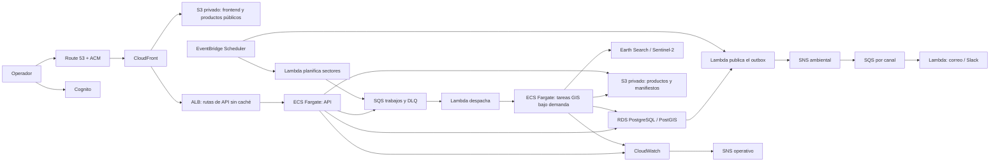

# Sentinela Selknam | Arquitectura DevOps en AWS

Propuesta para operar Sentinela en el sector argentino de la Isla Grande de Tierra del Fuego. El piloto permitiría a un equipo comparar recortes Sentinel-2, revisar resultados en forma compartida y recibir novedades. La adquisición programada avanza por sectores. Los cambios detectados se revisan antes de atribuirlos a castores.

## Decisión de arquitectura

**Para un piloto institucional, recomiendo Terraform, S3/CloudFront, Cognito, una API en ECS Fargate con RDS PostgreSQL/PostGIS, lotes por demanda y CloudWatch.** Mantendría GitHub Actions para los controles de PR y usaría CodePipeline con CodeBuild para publicar en AWS si el objetivo también es demostrar experiencia en su ecosistema CI/CD. CodeDeploy queda como variante blue/green de la API. Para un equipo chico que ya opera en GitHub, simplificaría a GitHub Actions con OIDC para todo el CI/CD.

El [primer avance](primer-avance/README.md) ya compara recortes en un Worker del navegador, tiene pruebas en GitHub Actions y publica una demo en GitHub Pages. La integración Supabase está preparada y sus permisos se verifican en PostgreSQL embebido. La plantilla histórica de [Lightsail](AWS.md) está pensada para otro prototipo, con Django y SQLite. La API FastAPI, los lotes gestionados, el pipeline AWS y el stack Terraform de este documento son trabajo propuesto. No hay despliegue verificado de este perfil.

## Vista general

### Cómo circulan los datos

1. **Acceso y lectura.** Route 53 resuelve un alias al CDN. ACM provee los certificados de CloudFront en us-east-1 y del ALB en la región de la aplicación. CloudFront lee S3 con Origin Access Control (OAC). El comportamiento de API deshabilita caché, reenvía la autorización y restringe el origen ALB a CloudFront mediante su lista de prefijos administrada más un encabezado de origen secreto. Cognito autentica. La API verifica firma, emisor, expiración, cliente y tipo de token y autoriza organización y rol. Los activos privados usan URLs firmadas de corta duración tras verificar permisos. [OAC](https://docs.aws.amazon.com/AmazonCloudFront/latest/DeveloperGuide/private-content-restricting-access-to-s3.html) · [Restricción de ALB](https://docs.aws.amazon.com/AmazonCloudFront/latest/DeveloperGuide/restrict-access-to-load-balancer.html)
2. **Procesamiento.** Una solicitud o EventBridge Scheduler dispara la selección de sectores y ventanas. Cada mensaje SQS lleva identificadores y parámetros acotados. Registrar solicitudes pendientes en PostGIS y reconciliarlas si falla el envío a SQS. La Lambda despachadora usa un cupo persistido de tareas activas, reclama la ejecución de forma atómica y lanza una tarea Fargate con token de idempotencia estable por intento. SQS confirma el despacho. El worker registra el resultado y una regla EventBridge recibe los eventos de tareas detenidas para reconciliar fallos. Se distinguen la DLQ del despacho, la DLQ de entrega de Scheduler y los fallos de cómputo posteriores al despacho. [SQS con Lambda](https://docs.aws.amazon.com/lambda/latest/dg/with-sqs.html) · [Idempotencia ECS](https://docs.aws.amazon.com/AmazonECS/latest/APIReference/ECS_Idempotency.html)
3. **Publicación.** La tarea guarda en S3 los recortes y productos con checksums y en PostGIS las ejecuciones y geometrías. Se conserva la identidad de la ejecución por área, fechas, escenas y versión del método. El worker necesita salida hacia los proveedores satelitales. El piloto presupone tareas privadas con NAT y un gateway endpoint de S3 para los buckets regionales. Las escenas de terceros pueden requerir otra ruta. [Método y límites actuales](primer-avance/README.md)
4. **Avisos.** Guardar el resultado y el evento de outbox en la misma transacción. Una Lambda programada publica en SNS y marca los intentos. Correo operativo y Slack pueden recibir mensajes simples de un tema técnico separado. Los avisos ambientales usan SNS para distribuir a colas por canal cuando se agrega un segundo destino. Cada entrega se deduplica por evento, destinatario y canal. Para empezar alcanza correo, con SNS email para un grupo fijo o SES cuando se necesite remitente propio y control de rebotes. Después, Slack por webhook autorizado. WhatsApp queda sujeto a una necesidad operativa y sus costos y condiciones. [Contrato y flujo de alertas](ARQUITECTURA_OBJETIVO.md#alertas-ambientales-y-de-operación-implementación-futura)

## CI/CD desde GitHub

```mermaid
flowchart LR
    PR[PR en GitHub] --> CHECK[GitHub Actions: tests y validación IaC]
    CHECK --> MAIN[Merge a rama protegida]
    MAIN --> CONN[AWS CodeConnections]
    CONN --> CP[CodePipeline V2]
    CP --> CB[CodeBuild: compila, prueba y empaqueta]
    CB --> ART[S3 + ECR: release por SHA]
    ART --> STG[Staging + smoke tests]
    STG --> OK[Aprobación de producción]
    OK --> RELEASE[S3 / CloudFront + ECS]
    RELEASE --> VERIFY[Smoke tests + alarmas / rollback]
```

| Paso | Implementación propuesta |
| --- | --- |
| PR | Reusar los controles de React y GIS y las verificaciones de datos existentes. Agregar `terraform fmt -check` y `terraform validate`. Un plan contra AWS requiere contexto de confianza y rol acotado. Los PR de forks carecen de acceso a roles y secretos del despliegue. Proteger `master` y exigir que pasen los controles antes del merge. |
| Fuente y compilación | Crear la conexión GitHub con Terraform y completar la autorización de la GitHub App en AWS. Limitarla a este repo. CodePipeline toma el commit de la rama protegida. CodeBuild usa `buildspec.yml` y scripts reutilizables para producir `dist`, imágenes en ECR, manifiesto SHA/digest y reportes. Promover el mismo artefacto entre ambientes. |
| Frontend | Publicar los recursos con nombre versionado primero y cambiar `index.html` al final. Cachear assets inmutables e invalidar el HTML de entrada. Conservar versiones y artefactos previos para revertir el HTML y validar la página. |
| API y tareas GIS | Aplicar migraciones compatibles con la versión anterior en un job controlado. Promover la API con ECS rolling y circuit breaker con rollback. La acción ECS estándar toma `imagedefinitions.json`. Las tareas GIS se actualizan por revisión de task definition validada, con un alias o referencia que usa el despachador. Guardar el digest y la versión del método por ejecución. |
| Blue/green como variante | Para practicar CodeDeploy, usar la acción `CodeDeployToECS` en la API con un servicio compatible, dos grupos de destino, `taskdef.json`, `appspec.yaml` e `imageDetail.json`. Validar green con un listener de prueba de acceso restringido, mover 10 % del tráfico, observar errores y latencia, y revertir por alarma o fallo de validación. ECS también ofrece blue/green nativo si se quiere esa estrategia con menos piezas. |
| Reversión | Preservar la referencia del último release sano. Probar que una imagen sin health check válido vuelve a esa versión en staging. Revertir la aplicación y aplicar una migración correctiva compatible si hubo cambio de esquema. Una copia de base es para recuperación de datos. |

Fuentes: [GitHub con CodeConnections](https://docs.aws.amazon.com/codepipeline/latest/userguide/connections-github.html) · [Artefactos ECS](https://docs.aws.amazon.com/codepipeline/latest/userguide/file-reference.html) · [CodeDeploy para ECS](https://docs.aws.amazon.com/codepipeline/latest/userguide/action-reference-ECSbluegreen.html) · [Blue/green nativo frente a CodeDeploy](https://aws.amazon.com/blogs/devops/choosing-between-amazon-ecs-blue-green-native-or-aws-codedeploy-in-aws-cdk/)

**Alternativa GitHub Actions con OIDC.** Ejecutar los mismos scripts para verificar, compilar, publicar en S3/ECR y promover a ECS. Usar roles separados para plan, infraestructura y publicación, confianza OIDC con audiencia STS y sujeto acotado al repositorio y ambiente, y las protecciones disponibles para ese ambiente. Restringir `iam:PassRole` a roles de tareas previstos. Elegir un solo flujo con permisos de publicación por ambiente para evitar despliegues simultáneos. Para un repositorio público con runners estándar, el cómputo de Actions puede quedar cubierto por GitHub. [OIDC en AWS](https://docs.github.com/en/actions/how-tos/secure-your-work/security-harden-deployments/oidc-in-aws) · [Facturación GitHub Actions](https://docs.github.com/en/billing/concepts/product-billing/github-actions)

## Terraform y puesta en marcha

| Raíz propuesta | Alcance |
| --- | --- |
| `infra/terraform/bootstrap` | Bucket de estado cifrado, privado y versionado. Backend S3 con `use_lockfile = true` y acceso por rol. Crear el backend con el bootstrap y migrar su estado con acceso administrativo controlado. |
| `infra/terraform/environments/staging` y `prod` | Estados independientes, cuentas separadas para operación institucional, módulos compartidos y versiones de providers fijadas. La estimación mensual cuenta un entorno persistente y pruebas transitorias. |
| Módulos de plataforma | Red, TLS/DNS, S3/CloudFront, Cognito, RDS, ECS/ECR y secretos. Subredes privadas para datos, roles IAM de mínimo privilegio y credenciales de aplicación en Secrets Manager. Separar despliegue de código de infraestructura y definir quién controla la revisión de la imagen ECS para que un `apply` posterior no revierta la aplicación. |
| Módulos operativos | Scheduler, colas y DLQ, funciones, SNS, dashboards, alarmas, presupuesto, pipeline y permisos. Etiquetar proyecto, ambiente, dueño y centro de costo. Versionar logs y alarmas como configuración con retención explícita. |

Secuencia: crear bootstrap y entorno de pruebas → publicar primero el frontend → importar una ejecución de referencia y verificar acceso con dos operadores → habilitar una cola y un sector programado → probar un fallo de entrega y su DLQ → probar reversión y restaurar RDS/S3 en un entorno aislado → habilitar producción según métricas y costos medidos. Usar revisión del plan y aprobación de cambios de infraestructura, protección contra eliminación en producción y límites de aplicación simultánea. Tratar estado y planes como datos sensibles. [Backend S3](https://developer.hashicorp.com/terraform/language/backend/s3)

## Monitoreo y decisiones por servicio

| Servicio | Decisión para Sentinela |
| --- | --- |
| CloudWatch | Desde el primer despliegue. Logs JSON de API, workers, Lambdas y builds, con `request_id` y `run_id` para buscar un incidente. Métricas nativas de ALB/ECS/RDS/SQS y unas pocas de aplicación. Retención inicial de 14 días en staging y 30 en producción, sujeta a política operativa. |
| Grafana | Como segunda etapa, dashboard sobre CloudWatch en Amazon Managed Grafana si hay operadores que lo consultan y necesitan una vista común. Dashboard versionado con salud, cola, duración, costo y cobertura. |
| Prometheus | Sumar si la API expone métricas que ameritan histogramas, PromQL o portabilidad. Alloy recoge `/metrics` en ECS y envía mediante `remote_write` a Amazon Managed Service for Prometheus (AMP) usando SigV4. Acotar número de series e intervalo. IDs de ejecuciones y coordenadas van en logs, no como etiquetas. |
| Loki y Alloy para logs | Buen ejercicio en staging si se quiere mostrar LogQL y el flujo de un colector. Para producción, arrancar con CloudWatch Logs. Si se elige Loki, usar S3 para objetos, planificar costo del servicio que lo ejecuta y retención, y enviar desde Alloy solo las fuentes elegidas. Los logs nativos de Lambda pueden seguir en CloudWatch. Evitar pagar dos veces por la misma ingesta. |
| Route 53, CloudFront y Cloudflare | Route 53 + ACM + CloudFront para un perfil AWS, con un solo DNS autoritativo. Si la organización ya gestiona ese dominio en Cloudflare, mantener Cloudflare en modo DNS-only hacia el subdominio CloudFront evita otro proxy. Usar el proxy Cloudflare solo por un requisito explícito de seguridad o CDN, con TLS válido extremo a extremo, análisis de bypass de origen y reglas de caché verificadas. No se necesita duplicar zonas ni CDN. |
| EventBridge, SQS, Lambda y SNS | Scheduler pone el reloj. SQS amortigua los lotes y sus reintentos. Lambda despacha y adapta canales. SNS reparte avisos. El procesamiento GIS se ejecuta en contenedores bajo demanda por sus dependencias y duración variable. Aplicar el límite de tiempo de Lambda al decidir si un recorte pequeño merece un worker Lambda. |
| AWS Batch | Evaluar si aumentan los lotes por sector o si hacen falta prioridades, dependencias entre trabajos y una cola de cómputo gestionada. En ese caso, dejar a Batch la planificación del worker y mantener SQS solo donde haya una necesidad de desacople o entrega independiente. [AWS Batch](https://aws.amazon.com/batch/) |
| API Gateway HTTP API + Lambda | Alternativa para una API muy esporádica si la adaptación a Lambda se prueba con carga representativa. Ahorra ALB y cómputo continuo de API, alrededor de USD 33/mes brutos en el modelo, y conserva el costo de PostGIS y la salida de los workers. Verificar tiempos de arranque, conexiones y concurrencia. Cotizar API Gateway, Lambda y RDS Proxy si se necesita. |
| EKS y clúster propio de observabilidad | Diferir mientras el equipo y el tráfico sean chicos. Fargate y CloudWatch requieren menos administración para este piloto. Mantener staging efímero y elegir Multi-AZ cuando disponibilidad y recuperación lo justifiquen. |

Fuentes: [Grafana y fuentes admitidas](https://aws.amazon.com/grafana/faqs/) · [Alloy y AMP](https://grafana.com/docs/alloy/latest/reference/components/prometheus/prometheus.remote_write/) · [Loki con almacenamiento de objetos](https://grafana.com/docs/loki/latest/operations/storage/) · [Proxy de Cloudflare](https://developers.cloudflare.com/dns/proxy-status/)

Verificar disponibilidad con una sonda HTTPS programada fuera de la red de la API, y verificar el recorrido autenticado en staging. Umbrales iniciales para ensayar: tres sondas consecutivas fallidas, 5xx de API por encima del 2 % durante 10 minutos con tráfico suficiente, cola con mensajes de más de 30 minutos y DLQ con al menos un mensaje. Alertar también por almacenamiento bajo y ausencia de ejecuciones programadas. Los problemas de cobertura satelital requieren un aviso propio. Probar notificación, diagnóstico y recuperación antes de declarar operativos los umbrales.

Para demostrar el flujo DevOps, registrar una ejecución que vincule el commit con el artefacto desplegado y un recorte generado. Guardar evidencia de un fallo inducido en staging con su alarma y reversión, y de una restauración aislada con tiempo y pérdida de datos medidos. En el runbook, asignar responsables y documentar cómo revisar la DLQ, repetir una ejecución y recuperar la versión anterior.

## Presupuesto de referencia

Estimación en USD para `us-east-1`, tarifas públicas consultadas el 17 de noviembre de 2026. Se modela un entorno piloto continuo de 730 h/mes, 20 operadores, 100 recortes/mes de 5 min en promedio, 20 GiB en S3, 20 GiB que atraviesan NAT, 50 GB servidos por CloudFront y 20 publicaciones al mes. Se usa CloudFront por consumo, con la franquicia mensual de transferencia y solicitudes disponible en la cuenta. Las demás partidas se estiman sin créditos promocionales ni descuentos de compromiso. Recalcular en AWS Pricing Calculator para la región, uso y requisitos definitivos.

| Partida piloto | Supuesto de cálculo | USD/mes aprox. |
| --- | --- | ---: |
| API ECS Fargate Linux x86 | 1 tarea × 730 h × (0,25 vCPU × 0,04048 + 0,5 GB × 0,004445) | 9,01 |
| Worker GIS Fargate Linux x86 | 100 × 5/60 h × (1 vCPU × 0,04048 + 2 GB × 0,004445) | 0,41 |
| Application Load Balancer e IPv4 | 730 h × 0,0225 + 73 LCU-h × 0,008 + 2 IPv4 × 730 h × 0,005 | 24,31 |
| NAT zonal e IPv4 | 730 h × 0,045 + 20 GB × 0,045 + 730 h × 0,005 | 37,40 |
| RDS PostgreSQL Single-AZ | Supuesto de planificación: `db.t4g.micro` a 0,016/h × 730 h y 20 GiB gp3 a 0,115/GiB-mes. Verificar versión, créditos CPU y almacenamiento. | 13,98 |
| S3, ECR, Route 53 y CloudFront | S3 20 GiB y operaciones (~0,55), ECR 2 GB (~0,20), una zona DNS (0,50), CloudFront dentro de franquicia cuenta (0) | 1,25 |
| Cognito, Lambda, Scheduler, SQS y SNS | Volumen bajo de usuarios directos, funciones, sondas y mensajes. Reservar margen para reintentos y correo básico. | 0–1 |
| CloudWatch y secretos | 1 GB de logs/mes, ~5 métricas, ~10 alarmas estándar y pocos secretos | 3–5 |
| CodePipeline V2 y CodeBuild | 20 × 12 minutos sumados de acciones × 0,002 + 20 × 8 minutos de build × 0,005 antes de franquicias. Los despliegues más largos suman minutos. | 1,28 |
| **Total de referencia** | **Suma de partidas. Usar USD 85–100/mes como banda de planificación.** | **90,64–93,64** |

AWS cobra por capacidad y uso según el servicio. Aproximadamente dos tercios del subtotal vienen de ALB y NAT. Para blue/green con CodeDeploy, cotizar el perfil en la calculadora y contemplar el solapamiento de tareas y el tiempo de pipeline. Retención de datos y snapshots adicionales, transferencia entre zonas, dominio, impuestos, soporte y WhatsApp se cotizan por separado.

Tarifas: [Fargate](https://aws.amazon.com/fargate/pricing/) · [ELB](https://aws.amazon.com/elasticloadbalancing/pricing/) · [NAT e IPv4](https://aws.amazon.com/vpc/pricing/) · [RDS PostgreSQL](https://aws.amazon.com/rds/postgresql/pricing/) · [S3](https://aws.amazon.com/s3/pricing/) · [ECR](https://aws.amazon.com/ecr/pricing/) · [Route 53](https://aws.amazon.com/route53/pricing/) · [CloudFront](https://aws.amazon.com/cloudfront/pricing/pay-as-you-go/) · [Cognito](https://aws.amazon.com/cognito/pricing/) · [Lambda](https://aws.amazon.com/lambda/pricing/) · [Scheduler](https://aws.amazon.com/eventbridge/pricing/) · [SQS](https://aws.amazon.com/sqs/pricing/) · [SNS](https://aws.amazon.com/sns/pricing/) · [CloudWatch](https://aws.amazon.com/cloudwatch/pricing/) · [Secrets Manager](https://aws.amazon.com/secrets-manager/pricing/) · [CodePipeline](https://aws.amazon.com/codepipeline/pricing/) · [CodeBuild](https://aws.amazon.com/codebuild/pricing/) · [CodeDeploy](https://aws.amazon.com/codedeploy/pricing/)

| Alternativa | Presupuesto orientativo | Cuándo elegirla |
| --- | ---: | --- |
| Demo estática AWS + GitHub Actions | **USD 1–5/mes** con S3, CloudFront, Route 53 y TLS, dentro de la franquicia CloudFront. Se cobra el dominio aparte. | Portafolio económico. Conserva cálculo y revisiones locales. No incluye base compartida, procesamiento programado ni alertas. Se puede usar el dominio de CloudFront y prescindir de la zona Route 53. |
| Piloto administrado | **USD 85–100/mes**, con una sola réplica de API y una NAT zonal. | Piloto con usuarios, cola, datos y respaldo. Una falla de zona puede afectar disponibilidad. |
| Base de producción redundante | **USD 145–175/mes** de referencia para el mismo tráfico, con dos tareas API, dos NAT zonales y RDS Multi-AZ con réplica en espera. | Primer perfil con redundancia. Cotizar de nuevo con carga, política de backups y objetivos acordados. |
| Observabilidad opcional | **USD 14/mes** por 1 editor y 1 lector en Amazon Managed Grafana. AMP y Loki aparte. | Para presupuestar AMP, 1.000 series a 60 s son ~43,8 M de muestras/mes. A USD 0,90 por 10 millones resultan ~USD 3,94 brutos de ingesta, más almacenamiento y consultas. El cómputo de Alloy o un colector administrado se cotiza aparte. Loki autogestionado requiere cómputo, S3, retención y operación. |

Fuentes: [Amazon Managed Grafana](https://aws.amazon.com/grafana/pricing/) · [Amazon Managed Service for Prometheus](https://aws.amazon.com/prometheus/pricing/) · [AWS Pricing Calculator](https://calculator.aws/)

**Puesta en marcha DevOps, por única vez.** Reserva de 48–72 h de ingeniería a USD 25/h como supuesto editable para Terraform/IAM/red (14–20 h), CI/CD y reversión (12–18 h), observabilidad y alarmas (8–12 h), y despliegue, recuperación y runbook (14–22 h). Con 20 % de contingencia serían **USD 1.440–2.160**. Con 12 meses de piloto a USD 85–100/mes, el subtotal del primer año sería **USD 2.460–3.360**. El cálculo supone que API y worker entregan imágenes y migraciones listas. Desarrollo de esas piezas, migración de datos reales, calibración GIS, validación de campo, operación humana y gastos excluidos arriba se estiman por separado. [Presupuesto histórico de alcance mayor](AWS.md#presupuesto-de-planificación-en-usd)

Crear Budgets con alertas a USD 60, 85 y 100 para el piloto y revisar el costo tras la primera semana. Las alertas son informativas y pueden demorar. Controlar gasto con concurrencia limitada, cuotas de recortes por organización y día, lifecycle de S3/ECR, retención de logs y apagado de entornos efímeros. Medir costo, duración, bytes descargados y almacenamiento por 100 recortes antes de calcular cobertura programada de toda la isla.
