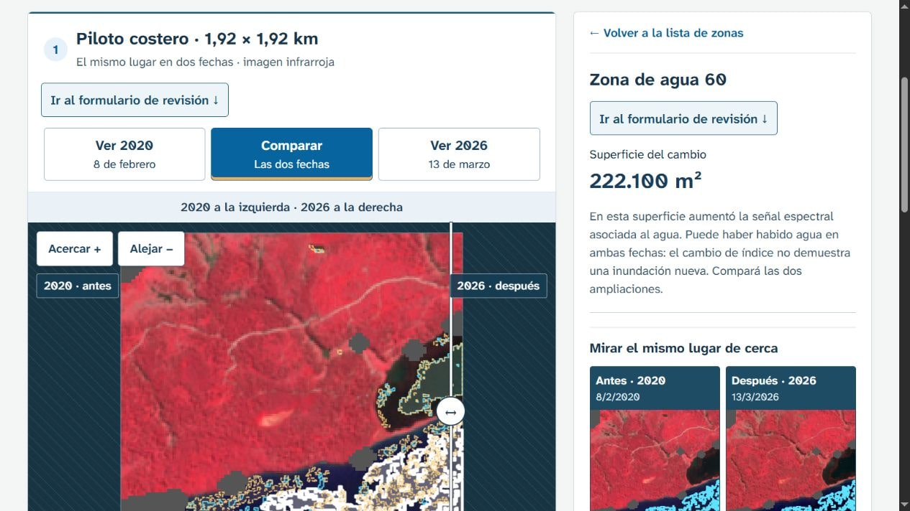

# Sentinela Selknam

**Eje Ambiente y Recursos Estratégicos** · [Hackatón SoberaníaTech 2026](https://soberaniatech.com.ar/bases)

[**Abrir la demo pública**](https://gastoncant.github.io/sentinela-selknam/) · [Guía de uso](primer-avance/GUIA_DE_USO.md) · [Diagrama AWS](documentacion/DEVOPS_AWS.md#flujo-del-piloto-aws)

## Problema y solución

**Problema.** Los diques de castores pueden modificar los cursos de agua y la vegetación de la Isla Grande. Para decidir dónde inspeccionar, los equipos ambientales necesitan ubicar los cambios y conservar la evidencia de cada caso. [Inventario histórico de diques en Tierra del Fuego](https://doi.org/10.1371/journal.pone.0232057)

**Solución.** Sentinela compara imágenes reales de Sentinel-2 del sector argentino de la Isla Grande. Señala cambios de agua y vegetación para revisar y permite registrar lo observado y compartir un informe.

## Uso de la demo

1. Tocá **Abrir piloto preparado** y mové el deslizador entre **2020** y **2026**.
2. Tocá **Elegir una zona para revisar** y abrí la **Zona de agua 60**. Compará las ampliaciones y tocá **Ir al formulario de revisión**.
3. Registrá tu observación, tocá **Guardar revisión** y abrí **Descargar revisiones** para obtener el PDF de la zona o el CSV del recorte.

El piloto tiene **95,7 % de superficie comparable** y **200 componentes espectrales** para revisar. Para atribuir un cambio a un dique se necesita evidencia independiente. [Pauta de validación](primer-avance/VALIDACION_FINAL.md)

<details>
<summary>Ver la captura y cómo interpretar el piloto</summary>



Se comparan el **8 de febrero de 2020** y el **13 de marzo de 2026** sobre **3,69 km²**. Los contornos celestes señalan aumento de la señal de agua (69 componentes) y los naranjas, disminución de la señal de vegetación (131). Ambas capas pueden superponerse. En la zona de agua 60 aumentó la señal en **222.100 m²**. En el ensayo se registró como **Falta información**, porque un cambio de nivel en la costa es una explicación posible.

Para analizar otro sector, elegí un punto en el mapa y tocá **Comparar este recorte**. El navegador consulta Earth Search y procesa **5,12 × 5,12 km** en una grilla de **10 m**. Podés exportar las geometrías, las imágenes y el manifiesto con escenas, fechas, grilla, método y hashes de las bandas muestreadas.

</details>

## Tecnologías y estado

- **Demo publicada.** React, TypeScript y Vite en GitHub Pages. Leaflet muestra el mapa. El análisis corre en un Web Worker que lee las bandas con GeoTIFF.js y transforma coordenadas con Proj4js. pdf-lib genera los informes. El navegador guarda los recortes recientes en IndexedDB y las revisiones en localStorage. [Módulos de la demo](primer-avance/MODULOS.md)
- **Arquitectura objetivo.** La integración con Supabase Auth y PostgreSQL está preparada para las revisiones compartidas del piloto. Queda pendiente conectar el proyecto remoto. El Terraform para AWS se verificó con planes simulados. El despliegue y las alertas se plantean para una etapa posterior. [Pruebas realizadas](primer-avance/VERIFICACION.md) · [Hoja de ruta](documentacion/ARQUITECTURA_OBJETIVO.md)

## Fuentes de datos

- **Imágenes satelitales.** Escenas Sentinel-2 L2A de Copernicus, consultadas a través de Earth Search de Element 84. El manifiesto registra las escenas del piloto, sus fechas y los hashes de los productos. [Catálogo de escenas](https://earth-search.aws.element84.com/v1/collections/sentinel-2-l2a) · [Manifiesto del piloto](docs/pilot/manifest.json)
- **Cartografía de referencia.** Contorno generalizado a partir de una capa del Instituto Geográfico Nacional de la República Argentina. Las localidades provienen de Georef. El selector usa OpenStreetMap para caminos y lugares y OpenTopoMap para el relieve. [Fuentes y hashes de la cartografía](docs/province/manifest.json)

## Licencias y recursos de terceros

- **Proyecto.** © 2026 Sentinela Selknam. El aviso de la demo reserva derechos sobre los contenidos originales del proyecto. La licencia general del código propio queda pendiente de definición.
- **Imágenes satelitales.** Contains modified Copernicus Sentinel data 2020 and 2026. [Licencia de Copernicus Sentinel](https://cds.climate.copernicus.eu/licences/ec-sentinel)
- **Cartografía.** El contorno derivado se rige por las condiciones del IGN. Los datos de Georef usan CC BY 4.0 y los de © OpenStreetMap contributors, ODbL. El mapa en línea de OpenTopoMap usa CC BY-SA. [IGN](https://riesgo.ign.gob.ar/pdf/Terminos-y-condiciones-de-uso-IGN.pdf) · [Georef](https://www.argentina.gob.ar/georef/condiciones-de-uso-y-licencia) · [OpenStreetMap](https://www.openstreetmap.org/copyright) · [OpenTopoMap](https://github.com/der-stefan/OpenTopoMap#readme)
- **Software y tipografía.** React, Vite, GeoTIFF.js, Proj4js, pdf-lib y el cliente de Supabase usan MIT. Leaflet usa BSD-2-Clause. TypeScript y PGlite usan Apache-2.0. Atkinson Hyperlegible Next usa SIL OFL 1.1. [Dependencias y versiones](primer-avance/package-lock.json) · [Avisos de pdf-lib](docs/licenses/pdf-lib.txt) · [Licencia tipográfica](docs/assets/OFL-Atkinson.txt)

## Integrantes

- Gastón Darío Cantero
- Carla Antonela Bensi

## Presupuesto

La estimación del primer año con AWS redundante es de **USD 14.640**. Incluye **USD 13.440** de implementación por etapas, con pruebas, validación de campo, capacitación y contingencia, y **USD 1.200** de infraestructura por doce meses a unos **USD 100 por mes**. Soporte y mantenimiento se cotizan aparte. [Desglose y supuestos](documentacion/DEVOPS_AWS.md#presupuesto-de-presentación-con-redundancia)

## Dónde está cada cosa

| Carpeta | Contenido |
| --- | --- |
| [primer-avance/](primer-avance/) | Código de la demo, guía de uso y pruebas. |
| [docs/](docs/) | Sitio publicado en GitHub Pages y documento del primer avance. |
| [documentacion/](documentacion/) | Arquitectura objetivo, presupuesto, criterios de validación y archivos de entrega. |
| [infra/terraform/](infra/terraform/) | Infraestructura AWS de referencia y ejemplos de CI/CD. |
| [prototipo-django/](prototipo-django/) | Prototipo anterior, con su Dockerfile, datos y pruebas. |

<details>
<summary>Ejecutar y verificar en local</summary>

Descargá el repositorio con **Code → Download ZIP** o clonalo con Git. Usá **Node.js 22.12 o superior** y ejecutá desde la raíz.

```sh
cd primer-avance
npm ci
npm run dev
```

Abrí la dirección que muestra Vite, normalmente `http://127.0.0.1:5173/`. En Windows también podés abrir [INICIAR_DEMO.cmd](INICIAR_DEMO.cmd) desde la raíz. Para verificar la compilación, el método, la cartografía y los permisos del piloto, ejecutá en `primer-avance/`.

```sh
npm run build
node verify-crop.mjs
node verify-province.mjs
node verify-db.mjs
```

</details>
