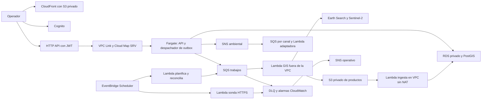

# Sentinela Selknam | Arquitectura DevOps en AWS

Sentinela compara recortes satelitales del sector argentino de la Isla Grande de Tierra del Fuego y conserva hallazgos para revisión ambiental. La demo actual usa GitHub Pages, Sentinel-2, un Worker del navegador e IndexedDB. El Terraform de este documento corresponde a una **implementación futura para la presentación final**. La API, las imágenes Lambda y las migraciones RDS están pendientes.

La revisión externa del 17 de noviembre de 2026 motivó tres ajustes: acercar el procesamiento a los COG de Sentinel-2, retirar NAT y ALB del piloto, y probar Lambda como ejecutor para recortes de 512 × 512 píxeles. Se eligió `us-west-2`, región donde se alojan `sentinel-cogs` y los recursos C1 L2A de Earth Search. Los activos se deben resolver por escena y verificar, porque el catálogo también puede devolver otros orígenes. [Registro de datos abiertos de AWS](https://registry.opendata.aws/sentinel-2-l2a-cogs/)

## De la demo a la operación institucional

| Fase | Decisión | Criterio para avanzar |
| --- | --- | --- |
| Demo actual | GitHub Pages y procesamiento local. | Necesidad de revisiones compartidas. |
| Piloto con usuarios | Supabase Auth/Postgres con RLS y Lambda GIS opcional. Primero se debe verificar Supabase remoto y portar el worker. | La institución necesita operar datos y ejecución en su propia cuenta AWS. |
| Piloto AWS | Terraform en `us-west-2`, S3/CloudFront, HTTP API, Cognito, una tarea Fargate, RDS PostGIS y Lambda GIS. | Carga medida que justifica redundancia y objetivos de disponibilidad. |
| Producción redundante | Dos tareas de API y RDS Multi-AZ como base. El almacenamiento y las colas siguen administrados. | Validación de capacidad, failover, recuperación y costo en staging. |

El perfil de portafolio permite ensayar antes con S3/CloudFront, IaC, un recorte, una DLQ y un canario Lambda, dejando API y RDS para la siguiente fase. El [Terraform y su guía](../infra/terraform/README.md) incluyen los cinco perfiles, los contratos de las imágenes y los criterios de aceptación.

## Flujo del piloto AWS

- **Red.** El VPC Link descubre IP y puerto de ECS a través de Cloud Map con registros SRV. La tarea Fargate usa IPv4 pública para egress HTTPS. Solo el grupo del VPC Link puede abrir conexiones al puerto de la API. La ingesta privada llega a los productos por un gateway endpoint de S3 en la misma región. Se usa autenticación IAM de RDS para generar el token localmente y eliminar una llamada a Secrets Manager desde esa Lambda. El rol de ingesta solo puede escribir las tablas previstas. [Integración HTTP API con Cloud Map](https://docs.aws.amazon.com/apigateway/latest/developerguide/http-api-develop-integrations-private.html) · [RDS con autenticación IAM](https://docs.aws.amazon.com/AmazonRDS/latest/UserGuide/UsingWithRDS.IAMDBAuth.html)
- **Datos.** Registrar la intención antes del encolado y recuperar las pendientes. SQS limita la concurrencia y reintenta. El worker publica el manifiesto al final, con escritura condicional. Ingesta aplica un upsert por ejecución y escribe el outbox en una transacción. La API publica el outbox en SNS por medio de un proceso con control de concurrencia. Se separan rechazos de Scheduler, fallas de cómputo, fallas de ingesta y entregas por canal. Para lotes largos o mosaicos que se acercan al límite de Lambda, comparar AWS Batch y Fargate usando duración, bytes y costo medidos. [SQS con Lambda](https://docs.aws.amazon.com/lambda/latest/dg/services-sqs-configure.html)
- **Alertas.** SNS operativo envía avisos técnicos y SNS ambiental distribuye eventos que requieren revisión. Empezar por correo confirmado. Slack y WhatsApp necesitan adaptadores, autorizaciones y destinos concretos. Los mensajes ambientales hablan de candidatos a revisar. [Modelo de alertas](ARQUITECTURA_OBJETIVO.md#alertas-ambientales-y-de-operación-implementación-futura)
- **DNS y observabilidad.** Route 53 y ACM si hay dominio propio, o Cloudflare en modo DNS-only si su zona ya existe. CloudWatch recibe logs y métricas, controla edad de cola, DLQ, errores, salud exterior y RDS. Grafana y AMP son opcionales. Alloy y Loki dependen de una decisión explícita de telemetría, capacidad y retención.

## Entrega y recuperación

Terraform separa bootstrap y plataforma. Los estados futuros de staging y producción usan claves S3 distintas con locking. **GitHub Actions con OIDC es el camino recomendado.** El ejemplo de publicación del frontend queda en documentación. Como variante de portafolio, la misma infraestructura puede crear CodePipeline y CodeBuild para el frontend con una conexión GitHub autorizada y aprobación en producción. La API usa rolling de ECS con circuit breaker. CodeDeploy queda disponible para un canario del alias Lambda GIS del 10 % durante cinco minutos, con alarmas y reversión. La promoción de los servicios requiere imágenes finales, roles y scripts integrados al release. [Contratos y operación](../infra/terraform/README.md#cicd-y-operación)

Antes de habilitar producción, demostrar entrega de un aviso por DLQ, reversión de una candidata y restauración de RDS y objetos versionados. Comparar permisos de dos organizaciones y medir duración y datos recuperados. El ensayo de recuperación ya acreditado en el repositorio corresponde al prototipo SQLite.

## Presupuesto de referencia

Modelo para `us-west-2` en USD. Supone 730 h, 20 operadores, 100 recortes de 60 s con 2 GB, 100.000 solicitudes HTTP, 20 GiB de objetos, 50 GB servidos por CloudFront, 2 GB de imágenes y 20 publicaciones al mes. El caso base usa GitHub Actions en repo público. Se toma una instancia RDS de 2 GiB para darle margen a IAM DB Auth y PostGIS. El caso con 1 GiB de la revisión externa necesita medición antes de adoptarse.

| Partida del piloto | Fórmula o supuesto | USD/mes |
| --- | --- | ---: |
| Tarea API Fargate | 730 × (0,25 × 0,04048 + 0,5 × 0,004445) | 9,01 |
| IPv4 pública | Una tarea × 730 × 0,005 | 3,65 |
| HTTP API y Cloud Map | 0,10 por 100.000 solicitudes HTTP + 0,10 por instancia + 0,50 estimado de zona privada + 0,10 para consultas de descubrimiento | 0,80 |
| RDS PostGIS | Supuesto regional a confirmar: 730 × 0,032 + 20 × 0,115 para `db.t4g.small` y gp3 | 25,66 |
| Créditos CPU RDS | Reserva de 0 a 67 vCPU-h × 0,075; medir uso | 0–5,00 |
| Lambda GIS | 100 × 60 × 2 × 0,0000166667 | 0,20 |
| Lambda planificador, ingesta y sonda, EventBridge, SQS y SNS | Bajo volumen, incluida una sonda Lambda cada cinco minutos, antes de posibles franquicias | 0,10–0,75 |
| S3, ECR y secreto de administración | 20 GiB × 0,023 más operaciones, 2 GB × 0,10 y un secreto de RDS | 1,15 |
| CloudWatch | 1 GB ingerido, 14 alarmas base, tres métricas propias más retención. Cotizar alarmas por canal adicional | 2,80–3,50 |
| CloudFront y DNS | Reserva ilustrativa de 0–6 para tráfico y solicitudes según franquicia/geografía, más hasta 0,50 de zona pública. La franquicia publicada puede reducir esta partida; confirmar consumo de la cuenta | 0–6,50 |
| **Subtotal ilustrativo** | Sin créditos promocionales. No incluye impuestos, dominio, destinatarios de pago, soporte ni staging persistente | **43,37–56,22** |

El presupuesto de **USD 43–57/mes** es una banda de planificación para el perfil que efectivamente declara Terraform. El perfil preliminar de USD 30–45 de la revisión usaba RDS micro y supuestos más bajos de monitoreo y tráfico. Una configuración redundante agrega una tarea y su IPv4, otra instancia registrada y RDS Multi-AZ. Como sensibilidad, sumar aproximadamente USD 38–45 a la banda anterior hasta cotizar Multi-AZ, tráfico entre zonas y failover reales. ALB/NAT quedan fuera de ambos perfiles implementados. Si la política de red exige tareas privadas o un ALB, presupuestarlos como cambio de alcance. Los perfiles estático y de portafolio cierran bajo consumo, sin garantizar un total sin medir tráfico y tiempo de retención.

Fuentes de tarifa y supuestos para confirmar: [Fargate](https://aws.amazon.com/fargate/pricing/) · [IPv4/VPC](https://aws.amazon.com/vpc/pricing/) · [HTTP API](https://aws.amazon.com/api-gateway/pricing/) · [Cloud Map](https://aws.amazon.com/cloud-map/pricing/) · [RDS PostgreSQL](https://aws.amazon.com/rds/postgresql/pricing/) · [S3](https://aws.amazon.com/s3/pricing/) · [ECR](https://aws.amazon.com/ecr/pricing/) · [Lambda](https://aws.amazon.com/lambda/pricing/) · [CloudWatch](https://aws.amazon.com/cloudwatch/pricing/) · [CloudFront](https://aws.amazon.com/cloudfront/pricing/pay-as-you-go/) · [Calculadora de AWS](https://calculator.aws/)

### Puesta en marcha y primer año

| Trabajo | Supuesto de planificación | USD |
| --- | --- | ---: |
| Integración DevOps y ensayo | 40–60 h × 25, más 20 % de contingencia | 1.200–1.800 |
| Desarrollo de API, worker y pruebas de integración | 60–100 h × 25, más 20 % | 1.800–3.000 |
| Infraestructura 12 meses | 12 × USD 43–57 | 516–684 |
| **Subtotal técnico del primer año** | Suma de partidas de este escenario | **3.516–5.484** |

Las horas son supuestos, no cotización. La migración de datos reales, calibración de teledetección, validación de campo, soporte y alta institucional se estiman aparte. El [presupuesto histórico de alcance mayor](../prototipo-django/AWS.md#presupuesto-de-planificación-en-usd) incluye rubros de desarrollo que se deben conciliar antes de combinar importes. AWS Budgets ayuda a detectar desviaciones, y los límites de concurrencia, retención y almacenamiento controlan el consumo.
