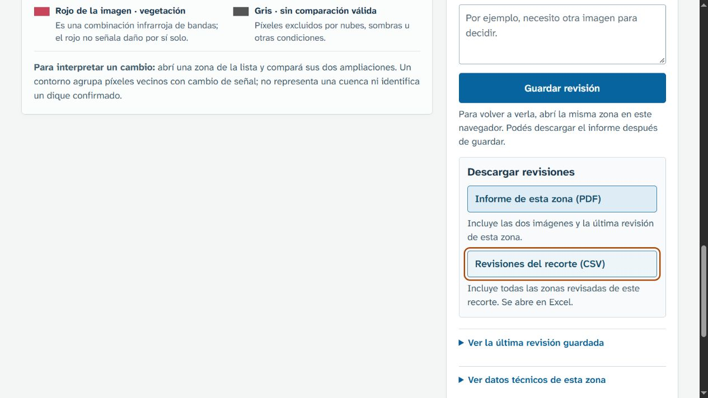

# Guía de uso de Sentinela Selknam

[**Abrir la aplicación**](https://gastoncant.github.io/sentinela-selknam/)

Sentinela compara imágenes satelitales del sector argentino de la Isla Grande de Tierra del Fuego. Permite ubicar cambios de agua o vegetación, registrar lo observado y descargar las revisiones. Para probar la demo pública podés usar un navegador moderno, como Edge o Chrome.

## 1. Elegí un recorte

1. En **Elegir un recorte**, tocá **Zona norte**, **Zona central** o **Zona sur**. También podés tocar un punto dentro del contorno de la isla. El cuadro naranja muestra el área seleccionada de **5,12 × 5,12 km**.
2. Cambiá entre **Relieve y ríos** y **Caminos y lugares** si necesitás orientarte. Estas capas sirven para elegir el lugar. Las imágenes que se comparan se abren en el paso siguiente.
3. Tocá **Comparar este recorte** y esperá la barra de progreso. La app busca imágenes de enero a marzo de 2020 y 2026. El porcentaje indica la etapa de preparación y la descarga puede tardar. Si querés volver a elegir, tocá **Cancelar descarga**.

Para practicar con datos ya preparados, tocá **Abrir piloto preparado** en la pantalla de selección. Para retomar una comparación anterior, buscala en **Recortes de este dispositivo** o usá **Volver al análisis abierto**.

## 2. Compará las imágenes

Usá **Ver 2020**, **Comparar** o **Ver 2026**. En **Comparar**, mové el deslizador para ver el mismo lugar en ambas fechas. Las etiquetas muestran la fecha efectiva de cada imagen.

| Qué ves | Cómo leerlo |
| --- | --- |
| Contorno celeste | La señal asociada al agua aumentó. Puede tratarse de agua que ya existía y cambió entre fechas. |
| Contorno naranja | La señal asociada a la vegetación disminuyó. |
| Rojo en la imagen | Es el color con que aparece la vegetación en la composición infrarroja. El rojo por sí solo no indica daño. |
| Píxeles grises | No hubo observación válida en ambas fechas. Pueden corresponder a nubes, sombras, nieve u otros datos excluidos. |

Mirá el porcentaje de **superficie comparable** para saber qué parte pudo usar el análisis. Los contornos marcan cambios detectados y requieren evidencia adicional para atribuirlos a castores.

## 3. Guardá una revisión

1. Tocá **Elegir una zona para revisar** y después **Revisar** en la lista. También podés tocar un contorno en el mapa. Si la lista es larga, filtrá por agua o vegetación.
   Podés activar **Solo zonas pendientes** y ordenar por **Mayor cambio de señal primero**. El orden ayuda a organizar la revisión y la decisión de inspeccionar requiere evidencia adicional.
2. En la ficha, mirá las dos ampliaciones. El encuadre y el contorno son los mismos en ambas fechas.
3. Tocá **Ir al formulario de revisión**. Elegí **Puede ser compatible con castores**, **Parece otra causa** o **Falta información**.
4. En **Motivo de la revisión**, escribí qué observás o qué falta comprobar. Tocá **Guardar revisión** y esperá la confirmación.

**Dónde queda guardada.** En la demo pública queda dentro del navegador, en el perfil y la dirección web que usaste. Para recuperarla, abrí el mismo recorte, elegí la misma zona y desplegá **Ver la última revisión guardada**. Cambiar de equipo, navegador, perfil o dirección web no transfiere las revisiones. Si borrás los datos del sitio, se eliminan las copias locales. La app conserva hasta seis recortes recientes, sujeto al espacio del navegador. Descargá los informes que necesites conservar o compartir.

## 4. Descargá las revisiones

Buscá **Descargar revisiones** debajo de **Guardar revisión**. El panel aparece cuando el recorte tiene al menos una revisión guardada. También lo encontrás al volver a **Cambios para revisar**.

| Opción | Qué contiene | Cuándo usarla |
| --- | --- | --- |
| **Informe de esta zona (PDF)** | Antes y después con el mismo contorno, fechas, área, cobertura y la última revisión guardada de la zona abierta. | Para compartir una ficha o adjuntarla a un informe. Desde la lista, abrí una zona revisada para habilitarlo. |
| **Revisiones del recorte (CSV)** | Una fila por zona revisada del recorte, con datos del análisis, estado y comentario. | Para comparar y filtrar revisiones en Excel, Calc u otra herramienta de datos. |

El archivo queda en **Descargas** del navegador. Si Excel abre el CSV en una sola columna, importalo desde **Datos → Desde texto/CSV** y elegí **UTF-8** y separador **punto y coma**. Los decimales usan coma.

Si necesitás los contornos para QGIS, abrí **Datos del análisis y descarga para especialistas** al pie de la página y descargá el **GeoJSON** del mismo recorte. Vinculá la columna `zona_id` del CSV con la propiedad `id` del GeoJSON. Ahí también están las imágenes PNG y el manifiesto JSON con las fuentes y los parámetros.

## Si algo no aparece

| Lo que pasa | Qué podés hacer |
| --- | --- |
| El recorte no tiene zonas para revisar. | Probá otro lugar o abrí el piloto preparado. Si la cobertura es baja, tomá ese dato al interpretar el resultado. |
| No aparece **Guardar revisión**. | Abrí una ficha desde **Cambios para revisar** y tocá **Ir al formulario de revisión**. |
| El botón PDF está deshabilitado. | Abrí una zona revisada o guardá la revisión de la zona actual. |
| La comparación tarda o falla. | Revisá la conexión o abrí el piloto preparado para seguir practicando. |

Para instalación local y Supabase, consultá la [guía técnica de la demo](README.md). Para ver cómo está construida, consultá el [inventario de módulos](MODULOS.md).
